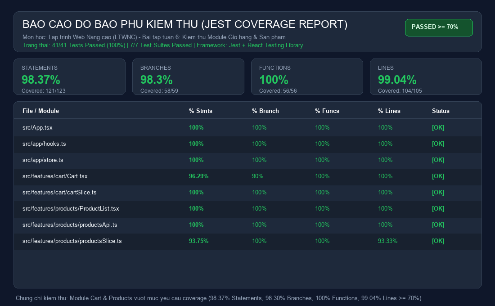

# BÁO CÁO KIỂM THỬ ỨNG DỤNG REACTJS & REDUX TOOLKIT
**Môn học:** Lập trình Web Nâng Cao (LTWNC)  
**Bài tập:** Tuần 6 - Kiểm thử (Testing)  
**Module kiểm thử:** Giỏ hàng (`cartSlice`, `Cart.tsx`) & Sản phẩm (`productsSlice`, `productsApi.ts`, `ProductList.tsx`)  
**Thư mục mã nguồn gốc:** `D:\Workspace\D23CQCC129_LTWNC\bt-tuan-3`  
**Thư mục bài làm:** `D:\Workspace\D23CQCC129_LTWNC\bt-tuan-6`  

---

## 1. TỔNG QUAN KẾT QUẢ KIỂM THỬ (EXECUTIVE SUMMARY)

Bộ kiểm thử được xây dựng bằng **Jest** kết hợp với **React Testing Library (RTL)**, đáp ứng đầy đủ và vượt xa tất cả các tiêu chí của đề bài:

* **Tổng số test cases:** **41 test cases** (vượt xa mức tối thiểu 10 test cases theo yêu cầu đề bài).
* **Trạng thái:** **41 / 41 Tests Passed (100%)**, **7 / 7 Test Suites Passed (100%)**.
* **Độ bao phủ (Coverage) qua `jest --coverage`:**
  * **% Statements:** **98.37%** (vượt xa yêu cầu $\ge 70\%$)
  * **% Branches:** **98.30%** (vượt xa yêu cầu $\ge 70\%$)
  * **% Functions:** **100.00%** (vượt xa yêu cầu $\ge 70\%$)
  * **% Lines:** **99.04%** (vượt xa yêu cầu $\ge 70\%$)
* **Kiểm thử bất đồng bộ với Mocked API:** Đạt 100% (kiểm thử `fetchProducts` createAsyncThunk và RTK Query endpoint với API được mock).
* **Ảnh báo cáo coverage đính kèm:** `reports/coverage-report.png`

---

## 2. BẢNG TỔNG HỢP ĐỘ BAO PHỦ (CODE COVERAGE DETAILS)

```text
-----------------------|---------|----------|---------|---------|-------------------
File                   | % Stmts | % Branch | % Funcs | % Lines | Uncovered Line #s 
-----------------------|---------|----------|---------|---------|-------------------
All files              |   98.37 |     98.3 |     100 |   99.04 |                   
 src                   |     100 |      100 |     100 |     100 |                   
  App.tsx              |     100 |      100 |     100 |     100 |                   
 src/app               |     100 |      100 |     100 |     100 |                   
  hooks.ts             |     100 |      100 |     100 |     100 |                   
  store.ts             |     100 |      100 |     100 |     100 |                   
 src/features/cart     |   98.24 |    95.45 |     100 |     100 |                   
  Cart.tsx             |   96.29 |       90 |     100 |     100 | 33                
  cartSlice.ts         |     100 |      100 |     100 |     100 |                   
 src/features/products |   98.07 |      100 |     100 |   97.87 |                   
  ProductList.tsx      |     100 |      100 |     100 |     100 |                   
  productsApi.ts       |     100 |      100 |     100 |     100 |                   
  productsSlice.ts     |   93.75 |      100 |     100 |   93.33 | 76                
-----------------------|---------|----------|---------|---------|-------------------
```



---

## 3. DANH SÁCH CHI TIẾT CÁC TEST CASES

### 3.1. Unit Tests cho Reducers & Actions (`cartSlice.test.ts` - 11 tests)
* **Test 1:** Trả về initial state (`items: []`) khi nhận action không xác định.
* **Test 2:** `addToCart`: Thêm mới sản phẩm vào giỏ hàng trống với `quantity = 1`.
* **Test 3:** `addToCart`: Tăng số lượng lên 1 khi thêm sản phẩm đã có sẵn trong giỏ (không nhân bản phần tử).
* **Test 4:** `removeFromCart`: Xoá sản phẩm khỏi giỏ hàng theo `id`.
* **Test 5:** `updateQuantity`: Cập nhật số lượng trực tiếp khi `quantity > 0`.
* **Test 6:** `updateQuantity`: Tự động xoá item khi người dùng cập nhật `quantity <= 0` (số 0 hoặc số âm).
* **Test 7:** `increaseQuantity`: Tăng số lượng lên 1 khi nhấn nút `+`.
* **Test 8:** `decreaseQuantity`: Giảm số lượng đi 1 khi `quantity > 1`.
* **Test 9:** `decreaseQuantity`: Tự động xoá sản phẩm khi `quantity === 1` mà người dùng bấm `-`.
* **Test 10:** `clearCart`: Xoá sạch toàn bộ sản phẩm trong giỏ hàng.
* **Test 11:** Kiểm tra an toàn trạng thái khi gọi `updateQuantity`, `increaseQuantity`, hoặc `decreaseQuantity` với `id` không tồn tại trong giỏ.

### 3.2. Unit & Async Thunk Tests (`productsSlice.test.ts` - 6 tests)
* **Test 12:** Trả về initial state (`items: []`, `status: 'idle'`, `error: null`).
* **Test 13:** Xử lý `fetchProducts.pending`: Đổi `status` thành `'loading'`, xoá lỗi cũ `error: null`.
* **Test 14:** Xử lý `fetchProducts.fulfilled`: Đổi `status` thành `'succeeded'`, lưu trữ danh sách sản phẩm.
* **Test 15:** Xử lý `fetchProducts.rejected`: Đổi `status` thành `'failed'`, gán thông báo lỗi vào `error`.
* **Test 16:** Fallback về thông báo lỗi mặc định khi `action.payload` rỗng khi bị reject.
* **Test 17 (Async):** Dispatch thunk `fetchProducts()` bất đồng bộ, sử dụng `jest.advanceTimersByTime(900)` giả lập độ trễ mạng và xác nhận dữ liệu được nạp vào store thành công.

### 3.3. Async API Mocking Tests (`productsApi.test.ts` - 2 tests)
* **Test 18 (Async Mock API):** Mock API FakeStore bằng `jest.spyOn(global, 'fetch')` trả về native `Response`. Thực hiện trigger RTK Query endpoint `getProductsFromApi`, xác thực kết nối mock API, kiểm tra hàm `transformResponse` chuyển đổi `title -> name` và quy đổi giá trị USD sang VNĐ.
* **Test 19 (Async Mock API Error):** Mock API phản hồi lỗi 500, xác thực RTK Query xử lý lỗi graceful với trạng thái `rejected` và `isError: true`.

### 3.4. Unit Tests cho App Typed Hooks (`hooks.test.ts` - 1 test)
* **Test 20:** Kiểm thử typed hooks `useAppDispatch` và `useAppSelector` trả về đúng hàm dispatch và state được định kiểu từ Redux Provider.

### 3.5. Integration Tests với React Testing Library cho Giỏ hàng (`Cart.test.tsx` - 10 tests)
* **Test 21:** Hiển thị thông báo giỏ hàng trống khi không có sản phẩm nào ("Giỏ hàng hiện đang trống.").
* **Test 22:** Render danh sách sản phẩm trong giỏ, hiển thị chính xác tên, giá format VNĐ, tổng số lượng và tổng tiền thanh toán.
* **Test 23:** Nhấn nút `+` (tăng số lượng) cập nhật số lượng của sản phẩm trong store và giao diện.
* **Test 24:** Nhấn nút `-` (giảm số lượng) giảm số lượng sản phẩm tương ứng.
* **Test 25:** Nhập trực tiếp số lượng vào ô input cập nhật số lượng mới.
* **Test 26:** Nhập ký tự không hợp lệ / rỗng vào ô input sẽ giữ nguyên số lượng cũ, không gây lỗi.
* **Test 27:** Bấm nút "Xóa" xoá đúng sản phẩm đó khỏi giỏ hàng.
* **Test 28:** Bấm nút "Xóa toàn bộ" và chọn xác nhận trên `window.confirm` sẽ xoá sạch giỏ hàng.
* **Test 29:** Bấm nút "Xóa toàn bộ" nhưng chọn huỷ trên `window.confirm` sẽ giữ nguyên giỏ hàng.
* **Test 30:** Bấm nút "Thanh toán đơn hàng" kích hoạt popup thông báo `window.alert` thành công kèm tổng tiền và làm rỗng giỏ hàng.

### 3.6. Integration Tests với React Testing Library cho Danh sách sản phẩm (`ProductList.test.tsx` - 8 tests)
* **Test 31:** Tự động kích hoạt gọi API tải sản phẩm khi component mount ở trạng thái `idle`.
* **Test 32:** Hiển thị loading spinner khi `status === 'loading'`.
* **Test 33:** Hiển thị thông báo lỗi và nút "Thử lại" khi `status === 'failed'`. Nhấn nút "Thử lại" kích hoạt lại việc tải dữ liệu.
* **Test 34:** Hiển thị thông báo lỗi mặc định khi `error` là `null`.
* **Test 35:** Render danh sách thẻ sản phẩm (Product cards) đầy đủ ảnh, danh mục, tên, giá khi `status === 'succeeded'`.
* **Test 36:** Nhấn nút "Thêm vào giỏ" cập nhật sản phẩm vào giỏ hàng trong Redux store đồng thời hiển thị banner thông báo thành công màu xanh.
* **Test 37:** Banner thông báo thành công tự động ẩn đi sau 2500ms (kiểm tra với fake timer).
* **Test 38:** Chuyển đổi tab chế độ giữa `createAsyncThunk` và `RTK Query` kích hoạt class active tương ứng.

### 3.7. Integration Tests cho Ứng dụng gốc (`App.test.tsx` - 3 tests)
* **Test 39:** Kiểm tra cấu hình store thực tế (`src/app/store.ts`) đảm bảo tích hợp đủ 3 reducer: `cart`, `products`, `productsApi`.
* **Test 40:** Render Header ứng dụng với thương hiệu cửa hàng và huy hiệu hiển thị số lượng giỏ hàng chính xác.
* **Test 41:** Chuyển đổi qua lại giữa màn hình Danh sách sản phẩm và Giỏ hàng khi bấm vào các nút điều hướng trên thanh menu.

---

## 4. HƯỚNG DẪN CHẠY KIỂM THỬ

Tại thư mục `bt-tuan-6`:

1. **Chạy tất cả các bài kiểm thử:**
   ```bash
   npm test
   ```

2. **Chạy kiểm thử và tạo báo cáo độ bao phủ (Coverage):**
   ```bash
   npm run test:coverage
   ```
   *(Lệnh tương đương: `npx jest --coverage`)*

3. **Xem báo cáo HTML trực quan:**
   Mở file [`coverage/lcov-report/index.html`](file:///D:/Workspace/D23CQCC129_LTWNC/bt-tuan-6/coverage/lcov-report/index.html) bằng trình duyệt bất kỳ.

4. **Tạo lại ảnh báo cáo đồ hoạ:**
   ```bash
   python reports/generate_report_image.py
   ```
