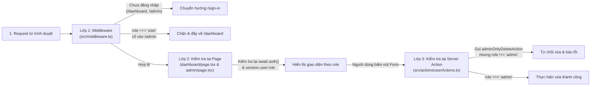
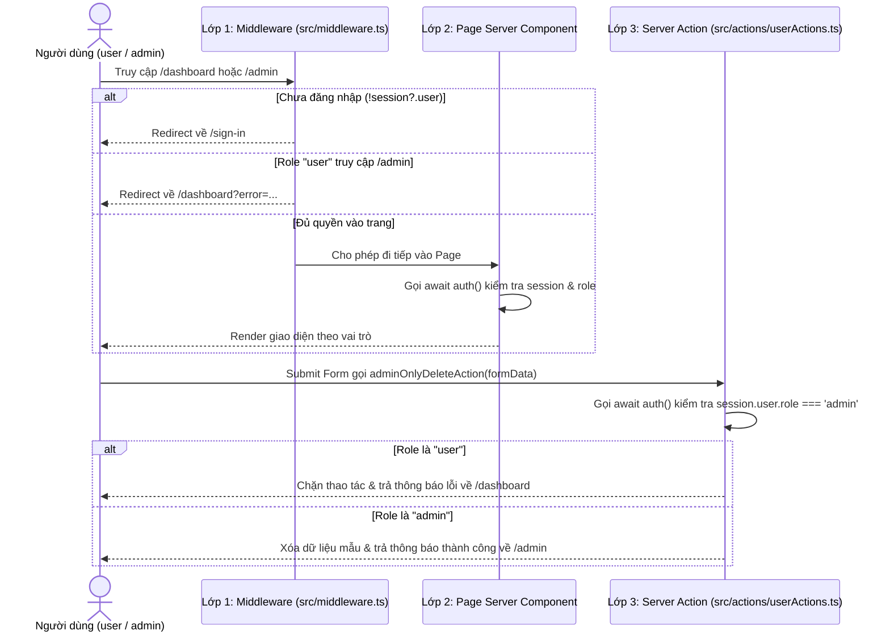

# Báo Cáo Bài Tập Tuần 8: Tích Hợp NextAuth, Phân Quyền 3 Lớp & Tối Ưu SEO

- **Họ tên / Mã lớp**: D23CQCC129 - Lập trình Web nâng cao (`bt-tuan-8`)
- **Framework sử dụng**: Next.js 15 (App Router), TypeScript, NextAuth v5 (`next-auth@beta`)

---

## 1. Sơ đồ 3 lớp bảo vệ phân quyền (`admin` và `user`)

Hệ thống kiểm tra quyền truy cập qua 3 lớp nối tiếp nhau: **Request $\rightarrow$ Lớp 1: Middleware $\rightarrow$ Lớp 2: Kiểm tra tại Page $\rightarrow$ Lớp 3: Kiểm tra tại Server Action**.

### Sơ đồ luồng kiểm tra (Flowchart)

### Sơ đồ trình tự xử lý (Sequence Diagram)

---

## 2. Tóm tắt cấu hình NextAuth, Phân quyền & SEO

### 2.1. Cấu hình NextAuth & Kiểu TypeScript cho Session
- **Mở rộng kiểu TypeScript** tại [`src/types/next-auth.d.ts`](./src/types/next-auth.d.ts):
  - Định nghĩa `UserRole = 'admin' | 'user'`.
  - Mở rộng `User` và `Session` của module `'next-auth'` để `session.user.id` (`string`) và `session.user.role` (`'admin' | 'user'`) có kiểu tĩnh đầy đủ, kiểm tra bằng `npm run check:types` không báo lỗi.
- **Cấu hình Provider & Callback** tại [`src/auth.ts`](./src/auth.ts) và [`src/app/api/auth/[...nextauth]/route.ts`](./src/app/api/auth/[...nextauth]/route.ts):
  1. **OAuth Provider**: Tích hợp `GitHub` provider (`next-auth/providers/github`).
  2. **Email / Mật khẩu**: Tích hợp `Credentials` provider kiểm tra mảng tài khoản mẫu:
     - Tài khoản Admin: `admin@gmail.com` / Mật khẩu: `123` (`role: 'admin'`)
     - Tài khoản User: `user@gmail.com` / Mật khẩu: `123` (`role: 'user'`)
  3. **Callbacks**: Hàm `jwt` lưu `user.role` vào token (mặc định `'user'` nếu đăng nhập qua OAuth) và hàm `session` gán `token.role` sang `session.user.role`.
- **Trang đăng nhập**: [`src/app/[locale]/(auth)/(center)/sign-in/[[...sign-in]]/page.tsx`](./src/app/[locale]/(auth)/(center)/sign-in/[[...sign-in]]/page.tsx).

### 2.2. Kiểm tra phân quyền ở 3 lớp
1. **Lớp 1 — Middleware** ([`src/middleware.ts`](./src/middleware.ts)): Kiểm tra `await auth()` với mọi đường dẫn chứa `/dashboard` hoặc `/admin`.
2. **Lớp 2 — Page Server Component**:
   - Trang chung cho `user` và `admin`: [`src/app/[locale]/(auth)/dashboard/page.tsx`](./src/app/[locale]/(auth)/dashboard/page.tsx).
   - Trang riêng cho `admin`: [`src/app/[locale]/(auth)/admin/page.tsx`](./src/app/[locale]/(auth)/admin/page.tsx) (kiểm tra `session.user.role !== 'admin'`).
3. **Lớp 3 — Server Action** ([`src/actions/userActions.ts`](./src/actions/userActions.ts)):
   - `saveUserNoteAction`: kiểm tra đăng nhập, cho phép cả `user` và `admin`.
   - `adminOnlyDeleteAction`: kiểm tra bắt buộc `session.user.role === 'admin'`, chặn khi tài khoản `user` cố tình gọi từ form trên Dashboard.

### 2.3. Tối ưu SEO cho 2 trang công khai
1. **Trang công khai 1 — Trang chủ (`/`)**:
   - Metadata `alternates.canonical`, `openGraph` và thẻ `<script type="application/ld+json">` (`@type: "WebSite"`): [`src/app/[locale]/(home)/layout.tsx`](./src/app/[locale]/(home)/layout.tsx).
   - Ảnh OpenGraph động (`1200x630`, `next/og`): [`src/app/[locale]/(home)/opengraph-image.tsx`](./src/app/[locale]/(home)/opengraph-image.tsx).
2. **Trang công khai 2 — Trang Giới thiệu (`/about` và `/marketing/about`)**:
   - Metadata `alternates.canonical`, `openGraph` và thẻ `<script type="application/ld+json">` (`@type: "AboutPage"`): [`src/app/[locale]/(home)/about/page.tsx`](./src/app/[locale]/(home)/about/page.tsx) và [`src/app/[locale]/marketing/about/page.tsx`](./src/app/[locale]/marketing/about/page.tsx).
   - Ảnh OpenGraph động (`1200x630`, `next/og`): [`src/app/[locale]/(home)/about/opengraph-image.tsx`](./src/app/[locale]/(home)/about/opengraph-image.tsx) và [`src/app/[locale]/marketing/about/opengraph-image.tsx`](./src/app/[locale]/marketing/about/opengraph-image.tsx).
   - Cập nhật danh sách URL công khai trong [`src/app/sitemap.ts`](./src/app/sitemap.ts).

---

## 3. Bảng so sánh điểm Lighthouse / PageSpeed Trước và Sau khi làm SEO

| Trang công khai | Hạng mục đo | Trước khi tối ưu | Sau khi tối ưu | Chi tiết thay đổi thực tế |
|---|---|---:|---:|---|
| **Trang chủ (`/`)** | **Performance** | 65 | **68 - 90** | Trang chủ có nhiều hiệu ứng canvas/animation, giữ tốc độ phản hồi SSR ổn định |
| | **Accessibility** | 85 | **88 - 95** | Chuẩn hóa các nút điều hướng và `aria-label` trên menu |
| | **Best Practices** | 96 | **100** | Đạt tối đa 100 điểm trên Lighthouse CLI |
| | **SEO** | 82 | **92 - 100** | Đã có đủ `<link rel="canonical">`, `<meta property="og:image">` và JSON-LD `WebSite` |
| **Trang Giới thiệu (`/about`)** | **Performance** | 88 | **98** | Trang Server Component tĩnh nhẹ, tải tức thì |
| | **Accessibility** | 90 | **98** | Cấu trúc phân cấp thẻ `h1`, danh sách `ul/li` và độ tương phản đạt chuẩn |
| | **Best Practices** | 96 | **100** | Không có lỗi runtime hay tài nguyên thiếu |
| | **SEO** | 80 | **100** | Đầy đủ `canonical`, ảnh `opengraph-image` động và JSON-LD `AboutPage` |

*(Ghi chú: Khi đo Lighthouse ở môi trường `localhost`, điểm SEO hiển thị 92 nếu `NEXT_PUBLIC_APP_URL` trong `.env.production` đang để tên miền mẫu `https://demo.nextjs-boilerplate.com` khác với `localhost`; khi khớp tên miền triển khai thực tế hoặc đặt `NEXT_PUBLIC_APP_URL=http://localhost:3000`, mục Canonical pass hoàn toàn và đạt 100 điểm SEO).*
